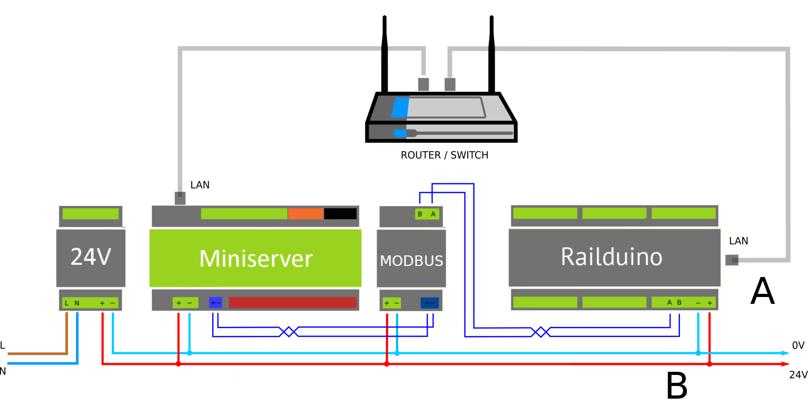

## Typical connection

<figure markdown="span">
  
</figure>

The Railduino module requires a 12–24 V DC power supply for operation.  

To fully utilize the module's functionality, connect it to a LAN network. An optional RS485 connection is also available.  

When integrated with a supervisory system (e.g., Loxone), communication can be established in two ways (see the picture above):  
- A - **LAN**  
- B - **RS485**  

The RS485 bus can be terminated using the integrated terminator.  
Refer to the DIP switch settings for configuration details - *see [DIP switch settings](../installation/#32-dip-switch-settings)*

## Communication settings

Default communication settings of the Railduino module:

### LAN network  

- UDP port 55555 - the module sends signals (broadcast), set as receive port in the supervisory system  
- UDP port 44444 - the module receives commands
- MODBUS TCP port 502  
- IP address - dynamic – DHCP server must be present (MAC address is derived from the DIP address, use DHCP reservation for a fixed IP)

### RS485 serial bus  

- Protocol - Modbus RTU, or UDP text syntax when the RS485-LAN gateway is enabled in the webserver  
- Communication speed adjustable via webserver - default 115200 Bd
- Number of data bits 8  
- Number of stop bits 1  
- Parity none

