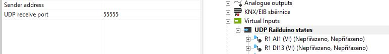
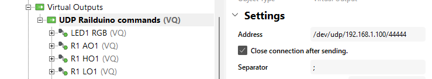

!!! note "Basic syntax"
	>"rail" + [add.] + " " + "[cmd]" + [no.] + "[state]"  
	
	e.g. "rail1 ro12 on"  where  
	
	- [add.] is physical address of Railduino  
	- [cmd] is command/signal  
	- [no.] is number of input/output  
	- [state] is e.g. on/off for output, 0/1 for input etc  

Commands / Outputs:
>      - relay on command: "rail1 ro12 on"  
>      - relay off command: "rail1 ro5 off"  
>      - high side switch on command: "rail1 ho2 on"  
>      - high side switch off command: "rail1 ho4 off"  
>      - high side switch PWM command: "rail1 ho1_pwm 180"
>      - low side switch on command: "rail1 lo1 on"  
>      - low side switch off command: "rail1 lo2 off"  
>      - low side switch PWM command: "rail1 lo1_pwm 180"  
>      - analog output command: "rail1 ao1 180"  
>      - reset command: "rail1 rst"

Signals / Inputs: 
>      - digital input state: "rail1 di1 1"  
>      - pulse count (DI10-12 with pulse sensing enabled): "rail1 di10 25"  
>      - analog input state: "rail1 ai1 1020.00"
>      - DS18B20 1wire sensor packet: "rail1 1w 2864fc3008082 25.44"  
>      - DS2438 1wire sensor packet: "rail1 1w 2612c3102004f 25.44 1.23 0.12"

!!! note "Ports and limits"
	- the module receives commands on UDP port **44444**  
	- the module sends signals as broadcast to UDP port **55555**  
	- max. length of one UDP command is **23 characters**

## RS485-LAN gateway

!!! note "Gateway function"
	The gateway is enabled in the [webserver](webserver.md) and works with outputs control protocol **UDP** only.  
	With the gateway enabled the RS485 bus uses the same text syntax as UDP (instead of Modbus RTU):  
	
	- each RS485 message must end with "\n" (or "\r"), max. 64 characters  
	- messages for this module are executed  
	- UDP commands for other modules (e.g. "rail3 ro1 on") are forwarded to RS485  
	- RS485 messages from other modules (e.g. "rail3 di1 1") are forwarded to LAN (UDP port 55555)  
	- signals of this module are sent to both LAN and RS485

## Loxone UDP settings for inputs

!!! tip "Insert new UDP virtual input for sensing inputs in Loxone Config and set the UDP receive port "55555""
	<figure markdown="span">
	
	</figure> 

## Loxone UDP settings for outputs

!!! tip "Insert new UDP virtual output and set the address "/dev/udp/192.168.x.x/44444""
	<figure markdown="span">
	
	</figure> 

